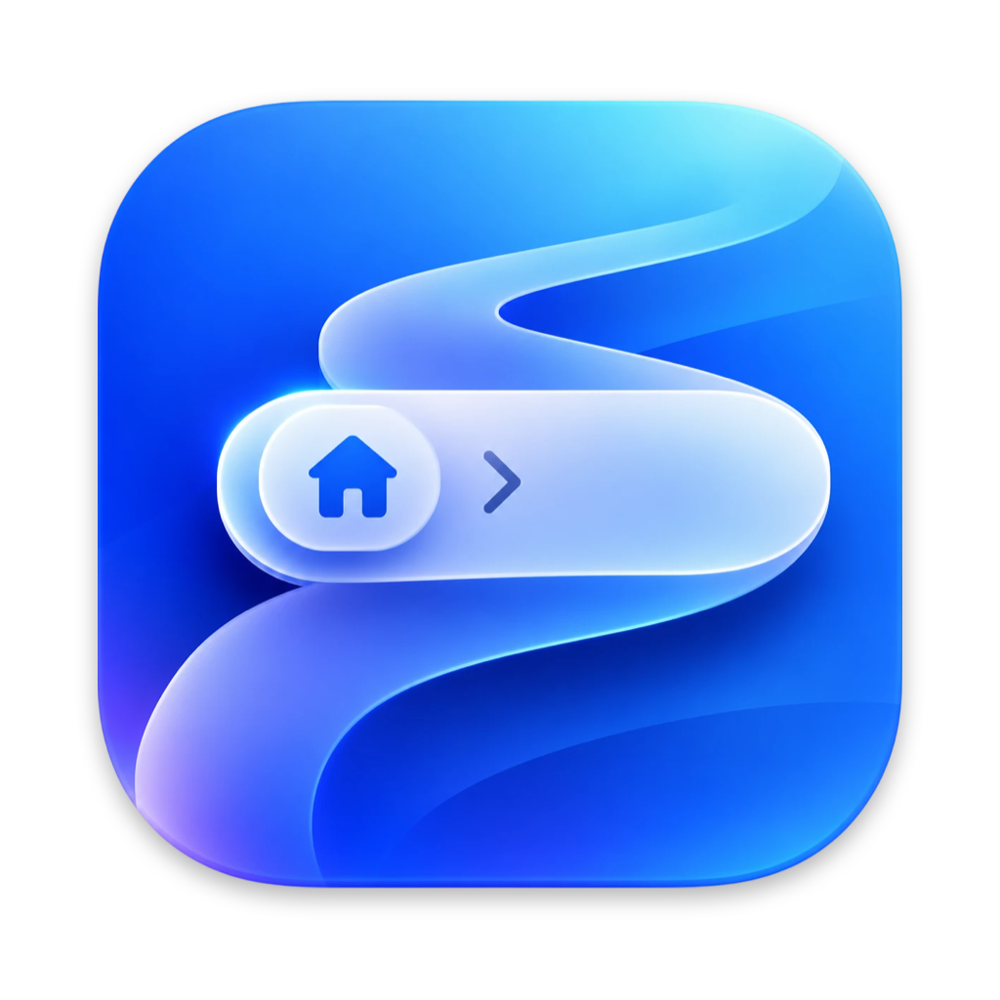
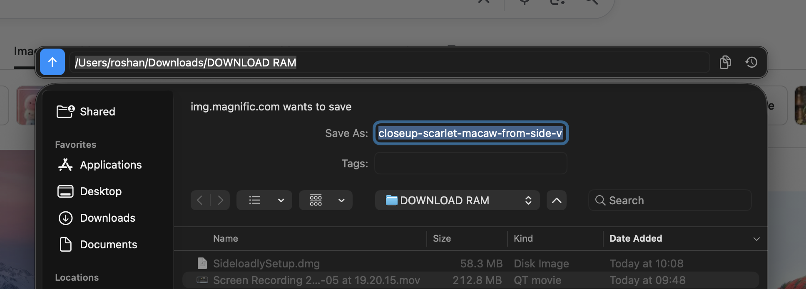
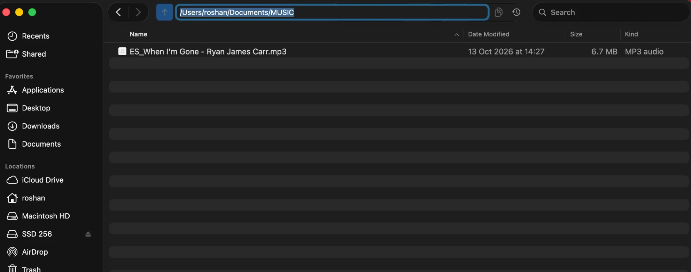

<p align="center">
  
</p>

<h1 align="center">PathBar</h1>

<p align="center"><b>A Windows-style address bar for macOS Save/Open dialogs and Finder windows.</b></p>

<p align="center">
  <a href="https://github.com/editorroshan/PathBar/releases/latest"><b>Download PathBar for Mac</b></a>
  · Apple Silicon &amp; Intel · macOS 13+ · Free &amp; open source
</p>

macOS file dialogs only show the current folder's name. PathBar adds a bar that shows the
**full path** of where you are. Click it, type or paste any path, press Return, and the
dialog (or Finder window) jumps straight there. It's handy when your browser asks where to
save a download.

### In a Save dialog (browser download)



### In Finder (click the folder name to show it)



## Features

- **Works in every app's Save and Open dialogs**: Chrome, Brave, Safari, Firefox downloads,
  "Save As…", "Open…", upload pickers.
- **Works in Finder windows**: click the folder name in the toolbar and the full path
  appears, ready to type. It disappears again when you're done.
- **Type or paste a path** and press Return to jump. `~`, quoted paths, `file://` URLs and
  paths copied from Terminal (`My\ Folder`) all work. **Tab** completes folder names.
- **↑** goes up one folder. **Copy** copies the full path.
- **Recent folders and open Finder windows** in one click (the clock button).
- **Drag a folder from Finder** onto the bar to jump there.
- Lives in the menu bar (folder icon), where you can turn it off for dialogs or for Finder.
- No network access, no tracking. Everything stays on your Mac.

## Requirements

- macOS 13 Ventura or newer (developed and tested on macOS 26 Tahoe)
- Apple's free Command Line Tools for the Swift compiler. The installer offers to install
  them if they're missing (or run `xcode-select --install`).

## Install

### Easiest: the app (no Terminal)

Download **PathBar-1.1.0.dmg** (from the Releases page, or from whoever shared it with you),
open it, drag **PathBar** onto **Applications**, then open it from Applications.

- macOS first says *"Apple could not verify PathBar…"*, because it's a free app that isn't
  notarized by Apple. Click **Done**, go to **System Settings → Privacy & Security**, scroll
  down to "PathBar was blocked…", and click **Open Anyway**. You only do this once.
- When asked, switch PathBar on in **Accessibility**. It adds itself to your login items.

Works on Apple Silicon and Intel Macs, macOS 13+. "Read Me First" in the DMG has the same
steps.

### From source

**With git:**

```bash
git clone https://github.com/editorroshan/PathBar.git
cd PathBar
bash install.sh
```

**Without git:** click **Code → Download ZIP** on GitHub and unzip it. Open **Terminal**,
type `cd ` (with a space), drag the unzipped `PathBar` folder into the Terminal window,
press Return, then run:

```bash
bash install.sh
```

The installer builds PathBar on your Mac, puts it in `~/Applications/PathBar.app` and
starts it at login. It needs no admin password. On a first install, macOS asks two things:

1. **Keychain:** "codesign wants to use the key PathBar Local Signing". Enter your Mac
   password and click **Always Allow**. (See *Why a signing certificate?* below.)
2. **Accessibility:** "PathBar would like to control this computer". Click
   **Open System Settings** and switch **PathBar** on.

That's it. Open any Save dialog to try it.

> **Double-click install:** `Install PathBar.command` does the same thing. macOS may block
> it the first time because it came from the internet. If so, use the Terminal steps above,
> or allow it under System Settings → Privacy & Security → "Open Anyway".

## Using it

| Where | What happens |
| --- | --- |
| Save / Open dialog | The bar floats just above the dialog, showing the full path. |
| Finder window | Hidden until you click the folder name in the toolbar. Then the path appears in its place, reaching up to the search field. Return, Esc, a click elsewhere or switching apps hides it. |

- **Click the path.** It's all selected, so just type or paste a new one.
- **Return** jumps there. **Esc** cancels. **Tab** completes a folder name.
- **↑** goes up a folder. In Finder this is Finder's own ⌘↑, so Back still works, and the
  bar stays open so you can keep going up.
- **⧉** copies the path. **⟲** lists recent folders and your open Finder windows.
  The first time, macOS asks to let PathBar read your Finder windows.

**Menu bar folder icon:** turn the bar on or off for dialogs, or just for Finder windows.
You can also open the log or quit.

## Update

```bash
cd PathBar
git pull
bash install.sh
```

Updates keep the Accessibility permission, so there's no need to allow it again.

## Uninstall

```bash
bash uninstall.sh          # removes the app and login item
bash uninstall.sh --all    # also deletes its settings and signing certificate
```

Then remove PathBar from System Settings → Privacy & Security → Accessibility (select it, click −).

## Why Accessibility permission?

PathBar has to see the dialog or Finder window that's open, read which folder it shows and
press its "Go to Folder" shortcut for you. On macOS that's what the Accessibility permission
is for. PathBar uses it only for that. It has no network code, and you can read every line
in `Sources/`.

## Why a signing certificate?

macOS remembers the Accessibility permission per app *signature*. An app built without a
certificate gets a new signature every time it's built, so every update would look like a
new app and the permission would have to be given again. Toggling the switch in System
Settings doesn't fix that.

So on first install, `setup-signing.sh` creates a personal certificate called
**PathBar Local Signing** in your login keychain. It's made on your Mac, used only by
Apple's `codesign` tool to sign PathBar, and isn't trusted system-wide. Every build is signed
with it, so macOS sees the same app and keeps the permission.
`bash uninstall.sh --all` deletes it.

## Troubleshooting

- **It keeps asking for Accessibility, or switching it on does nothing.** Quit System
  Settings (⌘Q) and run `bash install.sh` again. If an old entry is stuck, run
  `sudo tccutil reset Accessibility local.pathbar.helper`, then reinstall and allow it once.
- **The bar doesn't appear.** Check the menu bar icon. A ⚠️ means the permission is missing.
  "Open Log" shows what PathBar sees (`~/Library/Logs/PathBar.log`).
- **Typing a path doesn't jump.** PathBar drives the dialog with ⌘⇧G and types the path, so
  that app must be in front. Keyboard layouts that move the G key (e.g. Dvorak) aren't
  supported yet.
- **Finder already has a path bar from another tool.** Turn off "Show Path Bar in Finder
  Windows" in PathBar's menu.

## How it works

PathBar is a small menu-bar app in Swift/AppKit with no dependencies. It is careful not to
slow down the apps you work in. It never polls them. It watches the window server's list of
windows (once a second, 4× a second for a moment after a click). Only when the front app
gets a new window does it ask that app, once, through the Accessibility API, whether it is a
Save/Open dialog (identifier `save-panel` / `open-panel`) or Finder's front window. It reads the
folder from the file list (each row carries its file URL) and the folder pop-up or window
title. In Finder that only happens when you click the title. While the bar is on screen it follows the
window using the window server's own position: every screen refresh while you drag, 10× a
second when still. To jump, it opens the window's own **Go to Folder** sheet and enters the
path, the same thing you'd do by hand.

```
Sources/
  main.swift       app, watching and following windows, menu bar icon, settings
  Tracking.swift   window-server positions, Accessibility notifications, adaptive frame clock
  AX.swift         Accessibility helpers; finding dialogs and Finder windows; reading the folder
  Navigator.swift  jumping (Go to Folder), path parsing, Tab completion
  Bar.swift        the floating bar UI
install.sh         build + install from source (+ login item)
make-dmg.sh        build the drag-and-drop installer (DMG)
setup-signing.sh   one-time personal signing certificate
uninstall.sh       remove
Resources/         app icon (PathBar.icns), its artwork and the script that builds it
docs/              icon and screenshots for this page
```

### Developing

- `bash install.sh --no-login` builds and opens PathBar without the login item.
- `bash make-dmg.sh` builds the ready-to-run installer `dist/PathBar-<version>.dmg`, a
  universal app for Apple Silicon and Intel, signed with your PathBar certificate.
- Every build runs `PathBar --selftest` (path parsing, Tab completion, folder detection).
- Debug mode: `defaults write local.pathbar.helper debug -bool true`, then restart PathBar.
  It then accepts the distributed notification `local.pathbar.cmd` with `state`, `dump`,
  `snap`, `up`, `go:<path>`, `pid:<n>`, `dumpapp:<bundle id>`, `focus` or `blur`. Leave it
  off in normal use, because any program could send these.

## License

[MIT](LICENSE). Use it, change it, share it.
